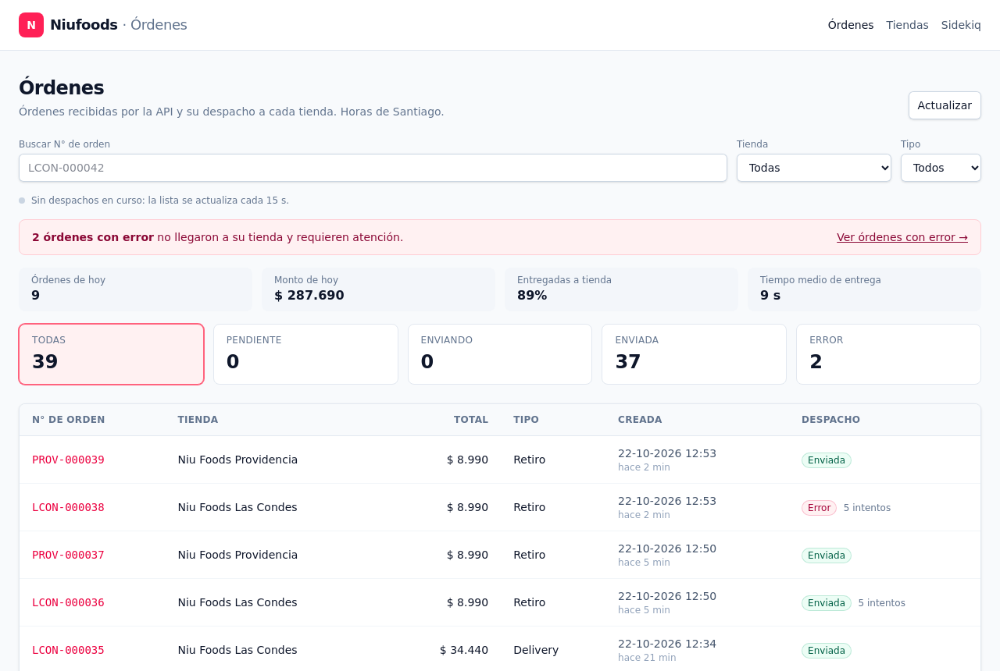
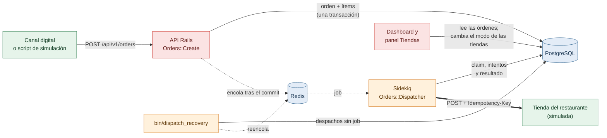
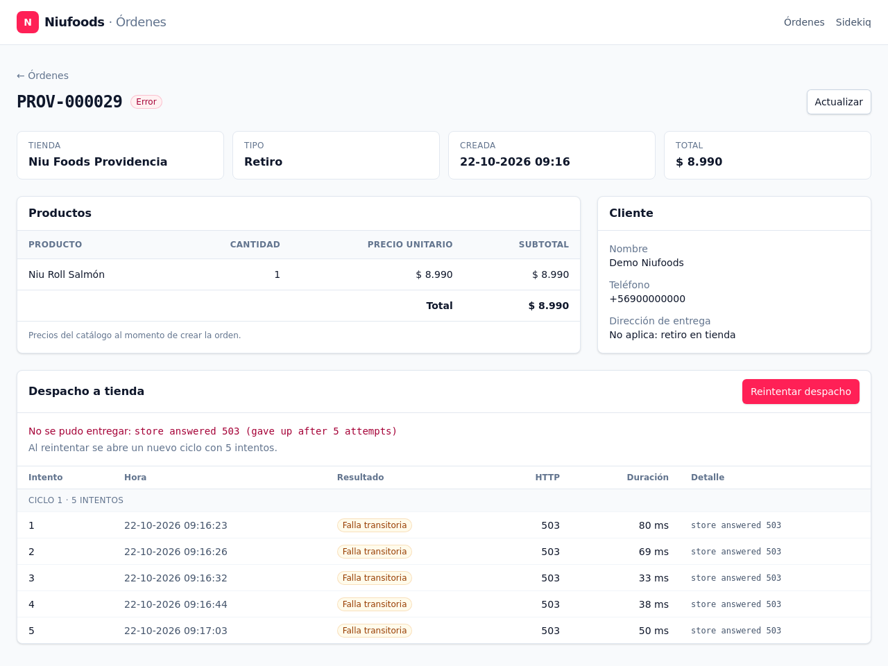

# Niufoods Orders

API central en Ruby on Rails que recibe las órdenes de los canales digitales de la franquicia, las valida, las guarda en PostgreSQL y las despacha por HTTP a la tienda que debe prepararlas. El despacho corre en segundo plano con Sidekiq, con reintentos y estado de despacho. Un dashboard permite revisar las órdenes y su despacho.

**El flujo de punta a punta:** una orden válida entra por `POST /api/v1/orders`, queda registrada con su total calculado en el servidor, se asocia a su restaurante, se despacha a la tienda de ese restaurante y aparece en el dashboard con su estado de despacho.

**Cómo leer el historial de commits:** cada `fix:` que sigue a un `feat:` corrige un hallazgo de revisión de código sobre ese commit; su mensaje explica el problema y la corrección.



## Contenido

- [Probar la solución en 5 minutos](#probar-la-solución-en-5-minutos)
- [Arquitectura en breve](#arquitectura-en-breve)
- [Uso de la API](#uso-de-la-api)
- [Simulación y tiendas simuladas](#simulación-y-tiendas-simuladas)
- [Dashboard](#dashboard)
- [Instalación y configuración](#instalación-y-configuración)
- [Decisiones técnicas](#decisiones-técnicas)
- [Tests, lint y CI](#tests-lint-y-ci)
- [Estructura del proyecto](#estructura-del-proyecto)
- [Limitaciones y trabajo futuro](#limitaciones-y-trabajo-futuro)

**Documentación detallada** en [`docs/`](docs):

| Documento | Contenido |
|---|---|
| [Arquitectura](docs/architecture.md) | Diagrama de componentes, modelo de datos (ERD) y flujo completo de una orden. |
| [API de órdenes](docs/api.md) | Contrato, validaciones, idempotencia, códigos de respuesta y de error. |
| [Despacho a tienda](docs/dispatch.md) | Estados, claim atómico con reserva temporal (*lease*), reintentos, recuperación, reintento manual y configuración. |
| [Tiendas simuladas](docs/simulated_stores.md) | Recepción, deduplicación atómica, modos de falla y el panel Tiendas. |
| [Simulación](docs/simulation.md) | Script de simulación de órdenes y escenarios de demo del despacho. |

## Probar la solución en 5 minutos

Requisitos: **Docker** con Docker Compose y **Ruby 3.x** en la máquina, solo para los dos scripts (usan únicamente la librería estándar, sin gemas).

```bash
git clone https://github.com/cristianrojasalexan/niufoods-orders.git
cd niufoods-orders
docker compose up --build        # PostgreSQL, Redis, app, Sidekiq y recuperación
```

El primer build tarda varios minutos. Cuando `web` responde, en otra terminal:

```bash
# 1. Generar órdenes desde los "canales digitales" (24 válidas y 6 inválidas a propósito)
ruby script/simulate_orders.rb --count 30 --seed 42

# 2. Ver el despacho en cuatro escenarios controlados: ok, inestable, rechazo y tienda caída (~1 minuto)
ruby script/demo_scenarios.rb
```

Después abre:

| URL | Qué hay |
|---|---|
| http://localhost:3000 | Dashboard de órdenes, en vivo, con filtros y el detalle de cada orden. |
| http://localhost:3000/stores | Tiendas simuladas: cambiar cómo responde cada una (por ejemplo, "Caída") y ver lo que recibió. |
| http://localhost:3000/sidekiq | Colas, reintentos programados y procesos de Sidekiq. |

Para ver reintentos y errores sin usar la terminal: en **Tiendas** pon una tienda en "Inestable" o "Caída", genera órdenes con el script y sigue en el dashboard cómo se reintentan.

Sin Ruby en la máquina, los mismos scripts corren dentro del contenedor: `docker compose exec web ruby script/simulate_orders.rb` (y lo mismo con `script/demo_scenarios.rb`).

Las dos ejecuciones terminan con código de salida `0`: todas las respuestas son las esperadas y los cuatro escenarios pasan. Esta secuencia se verificó desde un clon limpio del repositorio con volúmenes vacíos.

Para empezar de cero: `docker compose down -v && docker compose up --build`.

## Arquitectura en breve



1. **Recepción y validación.** El controlador filtra el payload con strong params. `Orders::Create` valida tipos, catálogo y reglas de negocio, y calcula el total con los precios de PostgreSQL.
2. **Persistencia.** La orden y sus ítems se guardan en una sola transacción, con el estado de despacho `pending`.
3. **Encolado.** El job se encola después del commit. Si Redis falla, la orden queda `pending` y `bin/dispatch_recovery` la encola cuando Redis vuelve.
4. **Despacho.** El worker reclama la orden en PostgreSQL con un `UPDATE` atómico, la envía a la tienda y registra el intento. Un error transitorio (5xx, 408, 425, 429, timeout) se reintenta con una espera que se duplica en cada intento (*backoff* exponencial), hasta 5 intentos por ciclo. Uno permanente (otros 4xx) la deja `failed`, y se puede reintentar desde el dashboard.

El detalle, con el diagrama completo de componentes, el ERD y el diagrama de secuencia, está en [docs/architecture.md](docs/architecture.md).

## Uso de la API

Ejemplos reales contra el stack de `docker compose`. El contrato completo y todos los códigos de error están en [docs/api.md](docs/api.md).

**Crear una orden** con el payload de referencia del enunciado. `Idempotency-Key` es opcional:

```bash
curl -i -X POST http://localhost:3000/api/v1/orders \
  -H 'Content-Type: application/json' \
  -H 'Idempotency-Key: demo-ana-001' \
  -d '{"restaurant_id":2,"order_type":"delivery","customer":{"name":"Ana Pérez","phone":"+56912345678"},"delivery_address":"Av. Providencia 1234, Santiago","items":[{"product_id":1,"quantity":2},{"product_id":5,"quantity":1}]}'
```

```
HTTP/1.1 201 Created
Location: http://localhost:3000/api/v1/orders/1
```

```json
{
  "id": 1,
  "number": "LCON-000001",
  "restaurant": { "id": 2, "code": "LCON", "name": "Niu Foods Las Condes" },
  "order_type": "delivery",
  "customer": { "name": "Ana Pérez", "phone": "+56912345678" },
  "delivery_address": "Av. Providencia 1234, Santiago",
  "items": [
    { "product_id": 1, "sku": "SKU-001", "name": "Niu Roll Salmón", "quantity": 2, "unit_price": 8990, "subtotal": 17980 },
    { "product_id": 5, "sku": "SKU-005", "name": "Gyozas de Pollo x5", "quantity": 1, "unit_price": 4490, "subtotal": 4490 }
  ],
  "total_amount": 22470,
  "currency": "CLP",
  "dispatch": { "status": "pending", "attempts": 0, "dispatched_at": null, "last_error": null },
  "created_at": "2026-10-22T12:15:37Z"
}
```

**Consultar la orden.** Unos segundos después ya está despachada:

```bash
curl http://localhost:3000/api/v1/orders/1
```

```json
"dispatch": { "status": "dispatched", "attempts": 1, "dispatched_at": "2026-10-22T12:15:40Z", "last_error": null }
```

**Reintentar con la misma `Idempotency-Key`.** Repetir exactamente el mismo comando devuelve la misma orden, sin crear otra:

```
HTTP/1.1 200 OK
Idempotent-Replayed: true
```

**Misma clave con otra solicitud** (por ejemplo, `quantity` 3 en vez de 2):

```
HTTP/1.1 409 Conflict
{"errors":[{"field":null,"code":"idempotency_conflict","message":"the Idempotency-Key was already used with a different request"}]}
```

**Errores de validación.** Todos usan la misma forma, con el campo en los términos del request:

```bash
# Producto inexistente
curl -s -X POST http://localhost:3000/api/v1/orders -H 'Content-Type: application/json' \
  -d '{"restaurant_id":2,"order_type":"pickup","customer":{"name":"Ana Pérez","phone":"+56912345678"},"items":[{"product_id":1,"quantity":2},{"product_id":99,"quantity":1}]}'
# 422 {"errors":[{"field":"items[1].product_id","code":"not_found","message":"does not exist"}]}

# Cantidad decimal: se rechaza en vez de truncarse
curl -s -X POST http://localhost:3000/api/v1/orders -H 'Content-Type: application/json' \
  -d '{"restaurant_id":2,"order_type":"pickup","customer":{"name":"Ana Pérez","phone":"+56912345678"},"items":[{"product_id":5,"quantity":2.5}]}'
# 422 {"errors":[{"field":"items[0].quantity","code":"invalid_quantity","message":"must be an integer between 1 and 99"}]}

# Delivery sin dirección
curl -s -X POST http://localhost:3000/api/v1/orders -H 'Content-Type: application/json' \
  -d '{"restaurant_id":2,"order_type":"delivery","customer":{"name":"Ana Pérez","phone":"+56912345678"},"items":[{"product_id":1,"quantity":2}]}'
# 422 {"errors":[{"field":"delivery_address","code":"blank","message":"can't be blank"}]}

# Total informado por el cliente que no coincide con el calculado
curl -s -X POST http://localhost:3000/api/v1/orders -H 'Content-Type: application/json' \
  -d '{"restaurant_id":2,"order_type":"pickup","customer":{"name":"Ana Pérez","phone":"+56912345678"},"items":[{"product_id":1,"quantity":2},{"product_id":5,"quantity":1}],"total_amount":10000}'
# 422 {"errors":[{"field":"total_amount","code":"total_mismatch","message":"does not match the calculated total of 22470"}]}

# JSON mal formado
curl -s -X POST http://localhost:3000/api/v1/orders -H 'Content-Type: application/json' -d '{"restaurant_id":'
# 400 {"errors":[{"field":null,"code":"malformed_json","message":"the request body is not valid JSON"}]}
```

| Status | Cuándo |
|---|---|
| `201 Created` | Orden creada. |
| `200 OK` | Consulta, o reintento con la misma `Idempotency-Key` y la misma solicitud. |
| `400 Bad Request` | JSON inválido, body vacío o `Idempotency-Key` mal formada. |
| `404 Not Found` | La orden no existe. |
| `409 Conflict` | La `Idempotency-Key` ya se usó con otra solicitud. |
| `422 Unprocessable Content` | La orden no cumple las reglas. |

## Simulación y tiendas simuladas

**`script/simulate_orders.rb`** simula los canales digitales. Está escrito en Ruby puro y habla con la API por HTTP, como cualquier cliente externo. Genera órdenes con el dataset de la prueba (de 1 a 5 productos, cantidades de 1 a 4, los 3 restaurantes, retiro y delivery) y mezcla órdenes inválidas a propósito: producto inexistente, cantidad 0 o 2.5, delivery sin dirección, total manipulado, restaurante inexistente y orden sin productos. Para cada orden verifica que la respuesta sea la esperada (201 o 422), informa los errores de red sin detenerse y termina con un resumen.

```
$ ruby script/simulate_orders.rb --count 30 --seed 42
...
Orders sent:             30
Created (201):           24
Invalid on purpose:      6 (rejected with 422: 6)
Network errors:          0
Unexpected answers:      0
Created by restaurant:   LCON=6, NUNO=11, PROV=7
Created by order type:   delivery=12, pickup=12
Total amount created:    $1146940
```

**Tiendas simuladas.** Cada restaurante tiene un `dispatch_url` que apunta a `POST /simulated_stores/:code/orders`. Es un endpoint aislado dentro de la misma app, que no usa los modelos de órdenes y guarda su propio estado. Deduplica por `Idempotency-Key` (el número de orden) de forma atómica: aunque la API reenvíe una orden, la tienda la registra una sola vez. Su comportamiento se cambia en caliente, desde la página **Tiendas** (`/stores`) o por HTTP:

```bash
curl -X PUT http://localhost:3000/simulated_stores/LCON/mode -H 'Content-Type: application/json' -d '{"mode":"flaky:2"}'
```

| Modo | Respuesta de la tienda |
|---|---|
| `ok` | `201` y la orden queda recibida (`200 duplicate` si ya la tenía). |
| `flaky:N` | `503` en los primeros N intentos de cada orden; después la acepta. |
| `reject` | `422` (error permanente: la orden queda `failed`). |
| `down` | `503` siempre (se agotan los intentos y la orden queda `failed`). |


**`script/demo_scenarios.rb`** corre un escenario por modo y compara lo esperado con lo obtenido: el estado, los intentos y lo que registró la tienda. Restaura el modo original de la tienda al terminar, aunque algo falle o se interrumpa con Ctrl-C.

```
Store mode  Expected                Got                     Store received    Result
----------  ----------------------  ----------------------  ----------------  ------
ok          dispatched, 1 attempt   dispatched, 1 attempt   yes (1 request)   PASS
flaky:2     dispatched, 3 attempts  dispatched, 3 attempts  yes (3 requests)  PASS
reject      failed, 1 attempt       failed, 1 attempt       no (1 request)    PASS
down        failed, 5 attempts      failed, 5 attempts      no (5 requests)   PASS
```

Más detalle en [docs/simulation.md](docs/simulation.md) y [docs/simulated_stores.md](docs/simulated_stores.md).

## Dashboard

- **`/`**: tabla con N° de orden, tienda, total en CLP, tipo (Retiro / Delivery), fecha y hora de creación en hora de Santiago (con "hace 3 min" debajo) y estado de despacho (Pendiente / Enviando / Enviada / Error), con la cantidad de intentos cuando hubo reintentos. Pagina de a 25 órdenes con Pagy, y toda la fila abre el detalle de la orden.
- **Filtros combinables:** búsqueda por número de orden, tienda y tipo de pedido. Las tarjetas superiores muestran el conteo por estado dentro de esos filtros y filtran por estado. Los filtros se aplican mientras se escribe o se elige, sin perder el foco, y quedan en la URL, así que una vista filtrada se puede compartir o recargar.
- **Lo que requiere atención:** justo bajo el título, un aviso con las órdenes con error y un enlace a ellas. Si alguna tienda simulada no está aceptando órdenes, una franja bajo el header lo indica en todas las páginas, para que una orden con error tenga su explicación a la vista. Además, los indicadores del día: órdenes, monto, porcentaje entregado a tienda y tiempo medio de entrega.
- **`/orders/:id`**: productos con cantidad, precio unitario y subtotal; datos del cliente y dirección; y los intentos de despacho como una **línea de tiempo por ciclo**, con resultado, código HTTP, duración, error y el tiempo entre intentos, donde se ve crecer la espera del *backoff*. Mientras el despacho sigue en curso, muestra el próximo intento.
- **Reintentar despacho**: el botón aparece solo en órdenes `failed`, pide confirmación y muestra "Reintentando…" mientras se envía. Abre un ciclo nuevo de intentos, y solo se aplica si la orden sigue `failed` en el mismo ciclo que mostraba la página, así que varios clics, o un clic desde una página desactualizada, abren a lo sumo un ciclo nuevo.
- **`/stores`**: panel de las tiendas simuladas, con su modo actual, botones para cambiarlo (Acepta / Inestable / Rechaza / Caída), cuántas órdenes recibió y cuántas solicitudes le llegaron, y sus últimas órdenes recibidas. Detalle en [Panel Tiendas](docs/simulated_stores.md#panel-tiendas).
- **Actualización en vivo:** las páginas se refrescan solas, cada 3 s mientras haya despachos pendientes o en curso y cada 15 s si no, para que aparezcan las órdenes nuevas; una etiqueta junto al título lo indica ("En vivo · 3 s"). Usa el *morphing* de Turbo 8: solo cambia lo que cambió, se mantiene el scroll y las filas que aparecen o cambian de estado se iluminan un momento. El refresco nunca pisa una búsqueda que se está escribiendo: espera a que se envíe y, si ya estaba en curso, actualiza todo menos el formulario. En una pestaña oculta, espera a que vuelva a estar visible.
- **Accesibilidad:** los conteos se anuncian a lectores de pantalla cuando cambian, el foco del teclado es visible y las animaciones se desactivan si el sistema pide reducir el movimiento.



## Instalación y configuración

### Con Docker (recomendado)

```bash
docker compose up --build
```

- Levanta `db` (PostgreSQL 16), `redis` (Redis 7), `setup`, `web`, `sidekiq` y `dispatch_recovery`.
- **Orden de arranque:** `setup` corre `db:prepare` y `db:seed` cuando `db` y `redis` están sanos. `web` arranca cuando `setup` termina bien, y `sidekiq` y `dispatch_recovery` cuando `web` responde. Así el primer inicio funciona desde cero. Compose aplica estas dependencias al levantar el stack; si después un servicio se reinicia solo, no vuelve a esperar a los demás.
- `web`, `sidekiq` y `dispatch_recovery` se reinician solos si se caen.
- Docker usa su propia base (`niufoods_orders_docker`) y la base 1 de Redis, separadas de las de la ejecución local.
- Los reintentos usan una base de 2 s (`DISPATCH_RETRY_BASE_SECONDS=2`) para poder verlos en vivo: una tienda caída agota sus 5 intentos en menos de un minuto.

### Local, sin Docker para la app

Requiere Ruby 3.4.11. PostgreSQL y Redis pueden venir del mismo `docker-compose.yml`:

```bash
docker compose up -d --wait db redis
bin/setup --skip-server   # gemas, base de datos y seeds
bin/dev                   # web, Tailwind, Sidekiq y recuperación (Procfile.dev)
```

**Si cambiaste valores en `.env`**, expórtalos antes de `bin/setup`. Solo `docker compose` y `bin/dev` (a través de Foreman) leen ese archivo por su cuenta; `bin/setup`, `bin/rails` (seeds, consola, migraciones) y los scripts no lo leen:

```bash
set -a; source .env; set +a      # exporta las variables de .env en esta terminal
bin/setup --skip-server          # usa, por ejemplo, el DB_PORT y el STORE_BASE_URL de .env
ruby script/demo_scenarios.rb    # usa el MAX_ATTEMPTS_PER_CYCLE de .env
```

También se puede pasar un valor puntual en la misma línea, como `DB_PORT=5433 bin/setup --skip-server` o `ruby script/demo_scenarios.rb --max-attempts 3`. Importa sobre todo con `STORE_BASE_URL`, que solo se aplica al cargar las seeds, y con `MAX_ATTEMPTS_PER_CYCLE`, que la demo necesita conocer para esperar los intentos correctos, también cuando la API corre en Docker.

`bin/rails db:seed` se puede correr cuantas veces se quiera: carga el dataset de la prueba con sus IDs originales mediante un *upsert* por ID, así que no duplica registros.

No corras `bin/dev` y el `web` de Docker al mismo tiempo, porque los dos usan el puerto 3000.

### Variables de entorno

Todas tienen un valor por defecto que funciona. Para cambiarlas, copia `.env.example` a `.env`. Ese archivo lo leen `docker compose` y `bin/dev`; para los demás comandos hay que exportarlo, como se explica en la [instalación local](#local-sin-docker-para-la-app).

| Variable | Default | Uso |
|---|---|---|
| `DB_HOST`, `DB_PORT`, `DB_USERNAME`, `DB_PASSWORD` | `localhost`, `5432`, `postgres`, `postgres` | Conexión a PostgreSQL. |
| `REDIS_URL` | `redis://localhost:6379/0` | Redis de Sidekiq. |
| `STORE_BASE_URL` | `http://localhost:3000/simulated_stores` | Base de los `dispatch_url` de los restaurantes al cargar las seeds. |
| `STORE_MODES` | `PROV=ok,LCON=ok,NUNO=ok` | Modo inicial de cada tienda simulada. |
| `MAX_ATTEMPTS_PER_CYCLE` | `5` | Intentos de despacho por ciclo. |
| `DISPATCH_RETRY_BASE_SECONDS` | `10` (`2` en `bin/dev` y Docker) | Espera base del *backoff* exponencial. |
| `DISPATCH_RETRY_MAX_SECONDS` | `300` | Tope de cualquier espera, incluido `Retry-After`. |
| `DISPATCH_LEASE_SECONDS` | `60` | Cuánto tiempo un worker tiene tomada una orden. Debe ser al menos el doble del plazo de una entrega (46 s); si no, la app no arranca. |
| `DISPATCH_RECOVERY_INTERVAL_SECONDS`, `DISPATCH_RECOVERY_GRACE_SECONDS` | `60`, `30` | Frecuencia y margen de la recuperación. |
| `SIDEKIQ_WEB_USER`, `SIDEKIQ_WEB_PASSWORD` | sin valor | Fuera de desarrollo, `/sidekiq` solo se monta con Basic Auth. |

## Decisiones técnicas

- **PostgreSQL decide, Sidekiq ejecuta.** El estado del despacho vive en la orden: intentos, próximo intento y qué worker la tiene tomada. El job solo lleva el `order_id`, y los reintentos automáticos de Sidekiq están desactivados (`retry: false`). Por eso un job duplicado, adelantado o perdido es inofensivo, y se puede auditar y razonar sobre el despacho mirando solo la base.
- **Claim atómico con reserva temporal y token.** Un único `UPDATE ... RETURNING` reclama la orden si le corresponde un intento, y le da al worker una reserva temporal (*lease*, 60 s por defecto) identificada con un token. Si el worker muere, la reserva vence y otro worker puede retomar la orden. Cada entrega HTTP tiene además un plazo total de 23 s, para que una tienda lenta no retenga al worker más allá de su reserva. El resultado se escribe solo si el token sigue vigente: un worker que perdió la reserva no pisa el resultado del que tomó su lugar, y su intento queda registrado como `stale`. El mismo `UPDATE` verifica el límite de intentos del ciclo, así que no se supera aunque haya jobs duplicados o workers que mueran a mitad de un intento.
- **Entrega con reintentos y recepción idempotente.** El worker reintenta los fallos transitorios hasta agotar el límite del ciclo, así que una tienda puede recibir la misma orden más de una vez; por ejemplo, si la aceptó pero su respuesta se perdió. Por eso la API envía el número de orden como `Idempotency-Key`, y la tienda lo usa para no registrar dos veces la misma orden.
- **Errores transitorios y permanentes se tratan distinto.** 5xx, 408, 425, 429, timeouts y errores de conexión se reintentan con *backoff* exponencial, respetando `Retry-After` si la tienda pide esperar más. El resto de los 4xx marca la orden como `failed` de inmediato, porque reintentar no cambiaría la respuesta.
- **Encolado después del commit, con recuperación.** El job se encola recién cuando la transacción se confirmó, así que el worker no busca una orden que todavía no es visible en la base. Si Redis no está disponible, la API igual responde `201` y la orden se recupera después. Se eligió así en vez de un *transactional outbox* por simplicidad (ver limitaciones).
- **El total lo calcula el servidor.** Se usan los precios de PostgreSQL, que quedan congelados en cada ítem. `total_amount` es opcional y solo sirve para que el canal confirme su cálculo. Los montos son enteros, porque el CLP no tiene decimales.
- **Los tipos del JSON se validan antes de convertir.** Una cantidad `2.5`, `"2"` o `null` responde `422`: no se trunca con `to_i`, ni se descarta en silencio un campo con forma incorrecta.
- **Integridad en la base, no solo en Rails.** Claves foráneas, `NOT NULL`, `CHECK` (cantidad positiva, subtotal coherente, estados válidos y sus columnas requeridas) e índices únicos protegen los datos aunque alguien escriba sin pasar por los modelos.
- **Idempotencia con huella de la solicitud.** La misma clave con la misma solicitud canónica devuelve la orden original (`200`); con otra solicitud, `409`. Las solicitudes simultáneas las resuelve un índice único.
- **Tienda simulada dentro de la app, pero aislada.** Un servicio aparte, por ejemplo en Sinatra, sumaría otro proceso e imagen sin aportar a la evaluación. El endpoint vive en su propio namespace, no usa los modelos de órdenes y tiene sus propias tablas. En producción bastaría con apuntar `dispatch_url` a la tienda real.
- **Rails con Hotwire y Tailwind para el dashboard.** Cumple lo pedido sin sumar un frontend SPA aparte, y queda en el mismo deploy. La actualización en vivo usa *morphing* de Turbo con un refresco periódico (cada 3 s con despachos en curso y cada 15 s sin ellos), en vez de Turbo Streams con WebSockets: para un panel interno da el mismo resultado sin sumar Action Cable.
- **Fechas:** el dashboard muestra la hora de Santiago (`config.time_zone`), y la API responde en UTC ISO 8601, como se espera de un contrato entre sistemas.

## Tests, lint y CI

```bash
bin/ci                 # ejecuta localmente todas las comprobaciones de abajo
bundle exec rspec      # suite de tests (RSpec + FactoryBot + shoulda-matchers + WebMock)
bin/rubocop            # estilo (rubocop-rails-omakase)
bin/brakeman           # análisis estático de seguridad
bin/bundler-audit      # vulnerabilidades conocidas en las gemas
```

La suite cubre, entre otras cosas:
- el cálculo de totales y `total_mismatch`;
- las cantidades inválidas;
- la idempotencia, también con solicitudes concurrentes en threads;
- el claim y la lease, incluido un worker obsoleto que no pisa el resultado;
- la clasificación de respuestas, el límite de intentos y el plazo total de una entrega;
- el total y la cantidad de ítems de una orden, también con ítems desactualizados en memoria;
- la recuperación;
- la tienda con recepciones concurrentes;
- el dashboard, el panel de tiendas y el reintento manual, también con clics concurrentes;
- que la cantidad de consultas de cada página no crezca con el número de tiendas;
- los dos scripts, corriendo contra la app real.

Los tests bloquean cualquier llamada HTTP real con WebMock.

En **GitHub Actions** (`.github/workflows/ci.yml`), cada push a `main` y cada pull request corre en jobs paralelos: Brakeman y bundler-audit, la auditoría de importmap, RuboCop y RSpec con PostgreSQL 16 y Redis 7 como servicios. Dependabot mantiene al día las gemas y las actions.

## Estructura del proyecto

```
app/
  controllers/api/v1/          API JSON (crear y consultar órdenes, errores uniformes)
  controllers/orders_controller.rb       dashboard, filtros, detalle y reintento manual
  controllers/stores_controller.rb       panel de las tiendas simuladas (/stores)
  controllers/store_simulator/ tiendas simuladas (recepción y modos), como API JSON
  javascript/controllers/      Stimulus: refresco en vivo, filtros, filas clickeables,
                               resaltado de cambios y avisos que se cierran
  views/                       dashboard, detalle, panel de tiendas y la etiqueta "en vivo" (shared/)
  services/orders/             Create, RequestFingerprint, Dispatcher, DispatchRetryPolicy,
                               DispatchRecovery, Redispatch, DailySummary
  jobs/dispatch_order_job.rb   ejecuta un intento de despacho
  models/                      Restaurant, Product, Order, OrderItem, DispatchAttempt, StoreSimulator::*
  serializers/                 representación JSON de la orden
bin/dispatch_recovery          proceso periódico de recuperación
db/data/                       dataset del enunciado (productos y restaurantes)
docs/                          arquitectura, API, despacho, tiendas y simulación
script/                        simulate_orders.rb y demo_scenarios.rb
spec/                          modelos, servicios, requests, jobs, integración y scripts
```

## Limitaciones y trabajo futuro

- **Autenticación de la API y de las tiendas.** Hoy la API no autentica a los canales. Lo siguiente sería API keys por canal, `Idempotency-Key` con alcance por cliente, y firma HMAC del payload que se envía a cada tienda.
- **Transactional outbox.** Entre el commit de una orden y el encolado de su job hay una ventana en la que una falla de Redis deja la orden sin job hasta la siguiente ronda de recuperación. Una tabla de eventos escrita en la misma transacción cerraría esa ventana.
- **Tests automatizados de la interfaz en el navegador.** Los request specs cubren lo que renderiza el servidor, pero no el JavaScript: el refresco en vivo, la protección de la búsqueda durante un refresco y el resaltado de filas se verificaron con un navegador real. El siguiente paso serían system tests con Capybara y un navegador headless en el CI.
