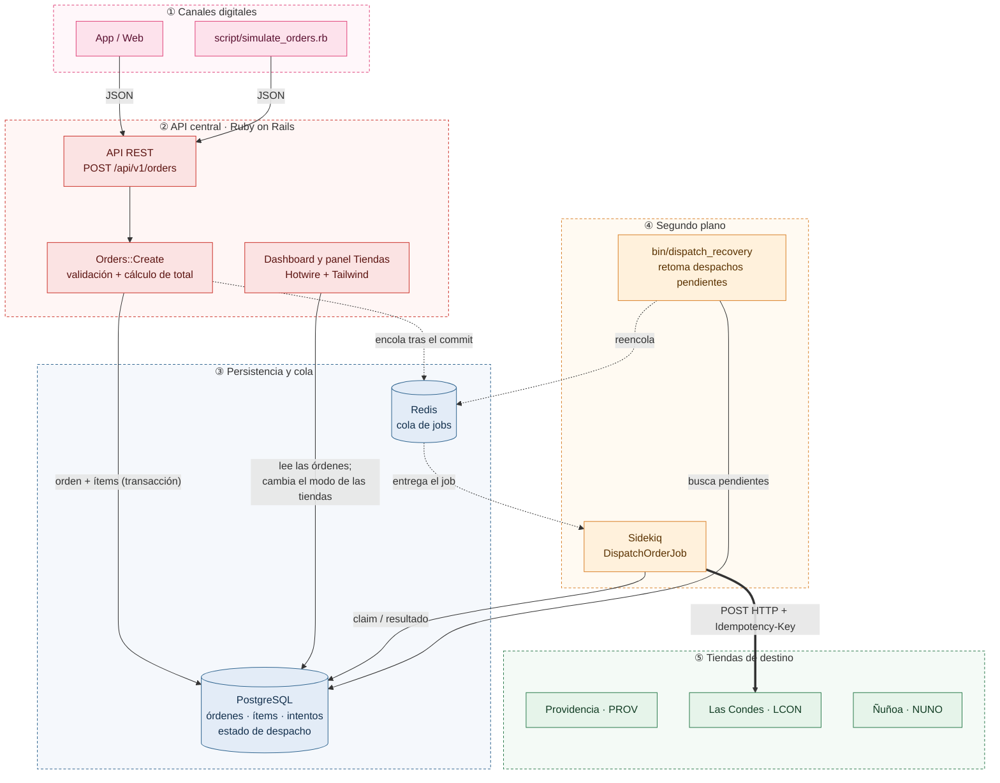
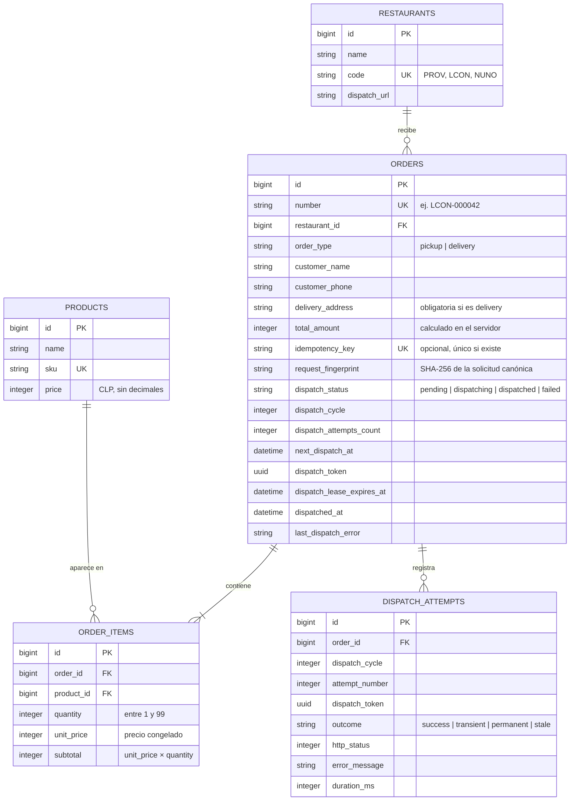
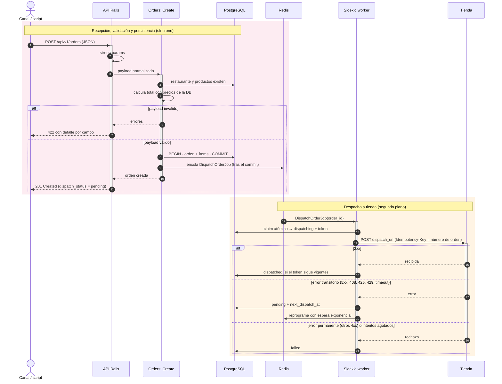

# Arquitectura

Este documento describe los componentes del sistema, el modelo de datos y el recorrido de una orden desde que llega por la API hasta que la recibe la tienda.

> Describe la solución tal como quedó implementada. El detalle del despacho (claim, reintentos, recuperación y reintento manual) está en [Despacho a tienda](dispatch.md).

- [Componentes](#componentes)
- [Modelo de datos](#modelo-de-datos)
- [Flujo de una orden](#flujo-de-una-orden)

## Componentes

| Componente | Responsabilidad |
|---|---|
| **API REST** (`Api::V1::OrdersController`) | Recibe el JSON, aplica strong params y traduce el resultado a una respuesta HTTP (201, 200, 400, 404, 409, 422). |
| **`Orders::Create`** | Valida la orden, calcula el total con los precios de la base de datos y guarda la orden y sus ítems en una sola transacción. |
| **PostgreSQL** | Fuente de verdad de las órdenes **y del estado de despacho**: intentos, próximo intento y lease del worker activo. |
| **Redis + Sidekiq** | Ejecutan el despacho en segundo plano. Sidekiq no decide cuántas veces reintentar; eso lo controla PostgreSQL. |
| **`bin/dispatch_recovery`** | Proceso periódico que retoma las órdenes que quedaron sin job, por ejemplo si Redis falló justo después de guardar la orden o si un worker murió a mitad de un despacho. |
| **Tiendas** | Reciben la orden por HTTP. En esta solución se simulan con un endpoint aislado dentro de la app (`/simulated_stores/:code/orders`). En producción serían sistemas externos y bastaría con cambiar `dispatch_url`. La página **Tiendas** (`/stores`), que es parte del dashboard, muestra cómo responde cada una y lo que recibió, y cambia su modo. |
| **Dashboard** | Muestra las órdenes con filtros y búsqueda, el resumen del día, las órdenes con error y el detalle de cada una con sus intentos de despacho como línea de tiempo, y permite reintentar manualmente un despacho fallido. Se actualiza solo con el *morphing* de Turbo: cada 3 s mientras hay despachos en curso y cada 15 s si no. |

Las flechas punteadas son comunicación asíncrona a través de la cola. La flecha gruesa es la entrega HTTP a la tienda de destino de cada orden; en el diagrama se dibuja hacia Las Condes, pero cada orden va a la tienda indicada en su `restaurant_id`.

## Modelo de datos

**Decisiones del modelo:**

- **Montos en enteros.** El peso chileno no usa decimales, así que precios y totales son `integer`. Se evitan los errores de redondeo de los `float`.
- **Precio congelado en cada ítem.** `order_items.unit_price` guarda el precio vigente al crear la orden. Si después cambia el catálogo, el total de las órdenes ya guardadas no cambia.
- **Un producto por orden aparece una sola vez.** Hay un índice único en `(order_id, product_id)`. Si el payload repite un producto, sus cantidades se suman en un solo ítem.
- **Integridad en la base de datos, no solo en Rails.** Claves foráneas, columnas `NOT NULL` y restricciones `CHECK` protegen los datos aunque alguien escriba sin pasar por los modelos: `quantity > 0`, `subtotal = unit_price * quantity`, `total_amount >= 0`, tipo de pedido válido y dirección obligatoria en delivery.
- **Total derivado de los ítems.** `total_amount` es la suma de los subtotales por cualquier camino de escritura a través de los modelos (SQL directo lo salta, como la regla de abajo sobre los ítems): `Order` lo calcula antes de validar con los ítems en memoria (así un total asignado desde afuera no se guarda y se puede comparar con el que envía el cliente) y guarda los ítems modificados junto con la orden (`autosave`). Como esos ítems en memoria pueden estar desactualizados si otro proceso cambió uno después de cargarlos, al terminar de guardar la orden el total se vuelve a calcular en SQL, con la orden bloqueada. Lo mismo ocurre cuando un ítem se crea, modifica o elimina por separado. Antes de escribir un ítem se bloquea la fila de la orden (`SELECT ... FOR UPDATE`), así que dos cambios simultáneos sobre la misma orden se serializan y el segundo calcula la suma con el primero ya confirmado.
- **Orden de bloqueo: siempre la orden antes que sus ítems.** Lo respetan la modificación de un ítem, `order.save!` (actualiza la orden y después los ítems) y `order.destroy!`, que bloquea la orden antes de la cascada de `dependent: :destroy`. Al usar un orden único se evitan deadlocks entre esos caminos. Si una modificación de ítem esperaba el lock de una orden que se eliminó, lanza `ActiveRecord::RecordNotFound` en vez de actualizar cero filas en silencio. Un ítem nuevo siempre toma el precio del catálogo, aunque se le haya asignado otro.
- **Una orden siempre tiene al menos un ítem.** Además de la validación en memoria, la cantidad se comprueba en la base con la orden bloqueada: al eliminar un ítem por separado, debe quedar otro; al guardar la orden, se revisa la cantidad final después de escribir los ítems, así que reemplazar el último ítem en un mismo guardado (marcarlo con `mark_for_destruction` y agregar otro) está permitido. Sí se puede eliminar la orden completa. A diferencia de las restricciones `CHECK`, esta regla la aplican los modelos y no PostgreSQL, así que `delete_all` o SQL directo la saltan. Llevarla a la base requeriría un trigger diferido, que `schema.rb` no guarda.
- **Un ítem no cambia de orden ni de producto.** `order_id` y `product_id` son de solo lectura una vez creado el ítem: moverlo dejaría desactualizado el total de la orden original, y cambiar su producto mantendría el precio del anterior. Para eso se elimina el ítem y se agrega otro.
- **Hasta 99 unidades por producto.** Es un límite de negocio razonable para una orden de restaurante y evita montos fuera de rango.
- **Número de orden legible.** El formato es `<código de tienda>-<id con 6 dígitos>` (por ejemplo, `LCON-000042`). El `id` se reserva desde la secuencia de la tabla antes de insertar, así que el número se guarda en el mismo `INSERT` y es único aunque lleguen órdenes en paralelo.
- **Despacho auditable.** Cada intento de entrega queda en `dispatch_attempts`, con su resultado, el código HTTP y la duración. El dashboard muestra ese historial.
- **IDs fijos en el catálogo.** Restaurantes (1 a 3) y productos (1 a 10) usan los IDs del dataset de la prueba, porque el payload los referencia directamente.

La tienda simulada guarda su propio estado en tablas separadas (`simulated_store_modes` y `simulated_store_requests`) que no se relacionan con el dominio de órdenes. Se describen en [Tiendas simuladas](simulated_stores.md).

## Flujo de una orden

1. **Recepción.** El controlador acepta exactamente el payload del enunciado y filtra los campos con strong params.
2. **Validación.** `Orders::Create` comprueba que el restaurante y los productos existan, que las cantidades sean enteros positivos y que una orden delivery traiga dirección.
3. **Cálculo y persistencia.** El total se calcula con los precios de la base de datos y no con el que informa el cliente. La orden y sus ítems se guardan en una sola transacción: o queda todo o no queda nada.
4. **Encolado.** El job se encola **después del commit**, para que el worker no busque una orden que todavía no es visible en la base. Si Redis no responde, la orden igual queda guardada como `pending` y el proceso de recuperación la toma cuando el servicio vuelve.
5. **Despacho.** El worker reclama la orden de forma atómica, la envía a la tienda y registra el resultado. Los errores transitorios se reintentan con espera exponencial, hasta un máximo de intentos por ciclo controlado en PostgreSQL. Los permanentes marcan la orden como `failed` y se pueden reintentar a mano desde el dashboard.
