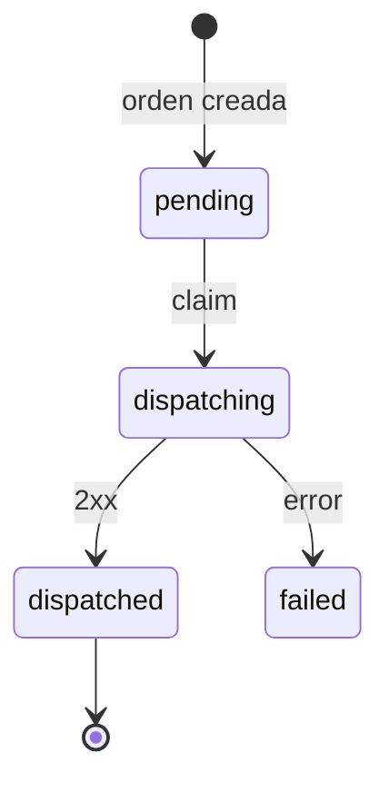

# Despacho de órdenes a tienda

Cuando se crea una orden, la API encola un job de Sidekiq que la envía por HTTP a la tienda de su restaurante (`restaurants.dispatch_url`). Este documento explica cómo se garantiza que cada orden llegue a su tienda de forma confiable.

## Principio: PostgreSQL decide, Sidekiq ejecuta

Todo el estado del despacho vive en la orden, en PostgreSQL: estado, intentos, próximo intento y qué worker la tiene tomada. El job de Sidekiq no guarda estado; solo recibe el `order_id` y le pide a `Orders::Dispatcher` que haga **un intento**.

Por eso un job duplicado, adelantado o atrasado es inofensivo: antes de hacer cualquier cosa, el dispatcher consulta en la base si corresponde despachar.

## Estados



| Estado | Significado |
|---|---|
| `pending` | Esperando un intento de despacho. |
| `dispatching` | Un worker la tiene tomada y la está enviando. Si la lease vence, otro worker puede retomarla sin salir de este estado. |
| `dispatched` | La tienda la recibió (`dispatched_at`). |
| `failed` | No se pudo entregar; `last_dispatch_error` indica el motivo. |

## Un intento, en tres pasos

### 1. Claim atómico

Un solo `UPDATE` condicionado toma la orden:

```sql
UPDATE orders
SET dispatch_status = 'dispatching',
    dispatch_token = '<uuid nuevo>',
    dispatch_attempts_count = dispatch_attempts_count + 1,
    dispatch_lease_expires_at = now() + make_interval(secs => 60)
WHERE id = ?
  AND dispatch_attempts_count < 5
  AND (
    (dispatch_status = 'pending' AND next_dispatch_at <= now())
    OR (dispatch_status = 'dispatching' AND dispatch_lease_expires_at < now())
  )
```

Si no cambia ninguna fila, el job termina sin hacer nada. Puede ser porque la orden todavía no corresponde, porque otro worker la tiene, porque ya terminó o porque se agotaron sus intentos. Como es una sola sentencia, dos workers nunca toman la misma orden al mismo tiempo.

**Lease:** el worker tiene la orden hasta `dispatch_lease_expires_at`. Si muere a mitad del envío, cuando la lease vence otro worker puede retomarla con un token nuevo. Eso también cuenta como intento. La lease (60 s) dura más que todo el request HTTP (3 s para conectar y 10 s para la respuesta); si no fuera así, la app no arranca.

### 2. Entrega

`POST` a `dispatch_url` con la orden en JSON (la misma representación de `GET /api/v1/orders/:id`) y estos headers:

```
Content-Type: application/json
Idempotency-Key: LCON-000042
```

El `Idempotency-Key` es el número de la orden. La entrega es **al menos una vez**: si un worker pierde la lease pero su request igual llegó a la tienda, la orden puede llegar dos veces, y la tienda la recibe solo la primera (ver [Tiendas simuladas](simulated_stores.md#deduplicación-atómica)).

### 3. Resultado, solo con el token vigente

El resultado se escribe con `UPDATE ... WHERE id = ? AND dispatch_token = <token del worker>`. Si otro worker retomó la orden mientras tanto, el token ya no coincide, no cambia ninguna fila y el resultado del worker antiguo se descarta. Así **un worker que termina tarde nunca sobrescribe el resultado del que lo reemplazó**.

## Clasificación de la respuesta

| Respuesta de la tienda | Resultado |
|---|---|
| `2xx` | `success` → la orden queda `dispatched`. |
| `408`, `425`, `429`, `5xx`, timeout, conexión rechazada | `transient`: la tienda podría aceptarla más tarde. |
| Cualquier otro `4xx` (y `3xx`) | `permanent`: reintentar no cambiaría la respuesta. |

> Por ahora, tanto los errores `transient` como los `permanent` dejan la orden como `failed`. Los reintentos de los errores transitorios se agregan en el siguiente paso de la implementación.

## Auditoría

Cada intento queda en `dispatch_attempts`, con ciclo, número de intento, token, resultado, código HTTP, error y duración:

| `outcome` | Significado |
|---|---|
| `success` | La tienda aceptó la orden. |
| `transient` | Falla que vale la pena reintentar. |
| `permanent` | Falla definitiva. |
| `stale` | El worker perdió la lease antes de terminar; su resultado se descartó. |

## Configuración

| Variable | Default | Uso |
|---|---|---|
| `MAX_ATTEMPTS_PER_CYCLE` | `5` | Intentos totales de un ciclo de despacho. |
| `DISPATCH_LEASE_SECONDS` | `60` | Cuánto tiempo un worker tiene tomada una orden. Debe ser mayor que 13 s. |
| `REDIS_URL` | `redis://localhost:6379/0` | Redis de Sidekiq. |

## Ejecutar el worker

```bash
bundle exec sidekiq -C config/sidekiq.yml
```

`bin/dev` lo levanta junto con el servidor. El worker procesa la cola `dispatch`.
