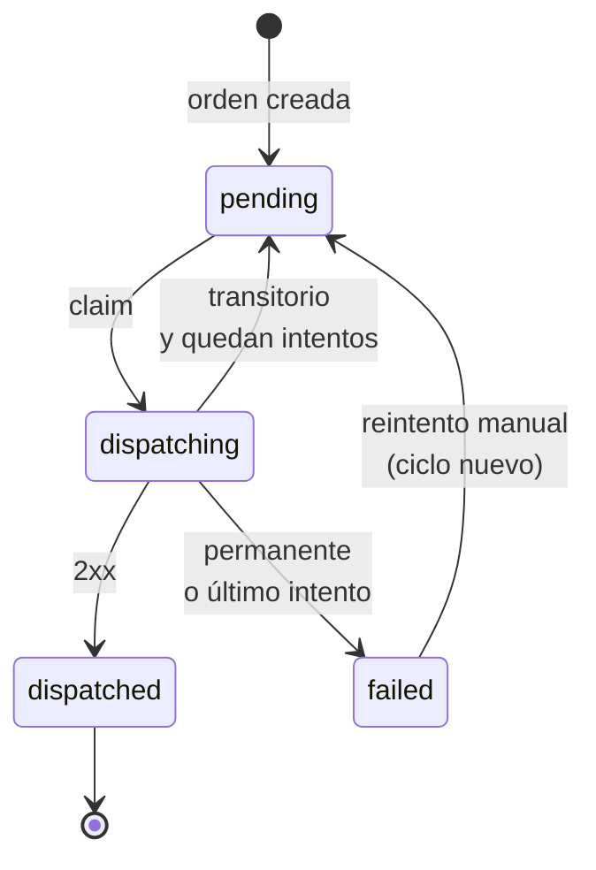

# Despacho de órdenes a tienda

Cuando se crea una orden, la API encola un job de Sidekiq que la envía por HTTP a la tienda de su restaurante (`restaurants.dispatch_url`). Este documento explica cómo se garantiza que cada orden llegue a su tienda de forma confiable.

## Principio: PostgreSQL decide, Sidekiq ejecuta

Todo el estado del despacho vive en la orden, en PostgreSQL: estado, intentos, próximo intento y qué worker la tiene tomada. El job de Sidekiq no guarda estado; solo recibe el `order_id` y le pide a `Orders::Dispatcher` que haga **un intento**.

Por eso un job duplicado, adelantado o atrasado es inofensivo: antes de hacer cualquier cosa, el dispatcher consulta en la base si corresponde despachar.

## Estados



| Estado | Significado |
|---|---|
| `pending` | Esperando un intento de despacho, el primero o un reintento programado para `next_dispatch_at`. |
| `dispatching` | Un worker la tiene tomada y la está enviando. Si la lease vence, otro worker puede retomarla sin salir de este estado. |
| `dispatched` | La tienda la recibió (`dispatched_at`). |
| `failed` | No se pudo entregar; `last_dispatch_error` indica el motivo. Se puede reintentar a mano desde el dashboard. |

## Un intento, en tres pasos

### 1. Claim atómico

Un solo `UPDATE` condicionado toma la orden:

```sql
UPDATE orders
SET dispatch_status = 'dispatching',
    dispatch_token = '<uuid nuevo>',
    dispatch_attempts_count = dispatch_attempts_count + 1,
    dispatch_lease_expires_at = now() + make_interval(secs => 60)
WHERE id = ?
  AND dispatch_attempts_count < 5
  AND (
    (dispatch_status = 'pending' AND next_dispatch_at <= now())
    OR (dispatch_status = 'dispatching' AND dispatch_lease_expires_at < now())
  )
```

La misma sentencia devuelve (`RETURNING`) el número de intento que le tocó a este worker, que es el que se registra en la auditoría. Si se leyera después, podría ser el de otro worker que retomó la orden entretanto.

Si no cambia ninguna fila, el job termina sin hacer nada. Puede ser porque la orden todavía no corresponde, porque otro worker la tiene, porque ya terminó o porque se agotaron sus intentos. Como es una sola sentencia, dos workers nunca toman la misma orden al mismo tiempo.

**Lease:** el worker tiene la orden hasta `dispatch_lease_expires_at`. Si muere a mitad del envío, cuando la lease vence otro worker puede retomarla con un token nuevo. Eso también cuenta como intento. La lease (60 s) dura más que todo el request HTTP (3 s para conectar y 10 s para la respuesta); si no fuera así, la app no arranca.

### 2. Entrega

`POST` a `dispatch_url` con la orden en JSON (la misma representación de `GET /api/v1/orders/:id`) y estos headers:

```
Content-Type: application/json
Idempotency-Key: LCON-000042
```

El `Idempotency-Key` es el número de la orden. La entrega es **al menos una vez**: si un worker pierde la lease pero su request igual llegó a la tienda, la orden puede llegar dos veces, y la tienda la recibe solo la primera (ver [Tiendas simuladas](simulated_stores.md#deduplicación-atómica)).

### 3. Resultado, solo con el token vigente

El resultado se escribe con `UPDATE ... WHERE id = ? AND dispatch_token = <token del worker>`. Si otro worker retomó la orden mientras tanto, el token ya no coincide, no cambia ninguna fila y el resultado del worker antiguo se descarta. Así **un worker que termina tarde nunca sobrescribe el resultado del que lo reemplazó**.

## Encolado y fallas de Redis

El job se encola **después del commit** de la orden, para que el worker nunca busque una orden que todavía no existe. Si Redis no está disponible en ese momento, la orden ya quedó guardada: la API responde igual `201`, la orden queda `pending` con `next_dispatch_at` vencido y se registra un warning en el log. Un reintento con la misma `Idempotency-Key` responde `200` con esa misma orden.

Esas órdenes las retoma la [recuperación](#recuperación) cuando los servicios vuelven a estar disponibles.

## Clasificación de la respuesta

| Respuesta de la tienda | Resultado |
|---|---|
| `2xx` | `success` → la orden queda `dispatched`. |
| `408`, `425`, `429`, `5xx`, timeout, conexión rechazada | `transient`: la tienda podría aceptarla más tarde. |
| Cualquier otro `4xx` (y `3xx`) | `permanent`: reintentar no cambiaría la respuesta. |

## Reintentos

Un error `transient` vuelve la orden a `pending` y guarda **en PostgreSQL** cuándo corresponde el próximo intento (`next_dispatch_at`). Después programa el job para ese momento con `perform_in`. Un error `permanent` deja la orden `failed` sin reintentar.

**Intentos por ciclo.** Cada ciclo de despacho admite `MAX_ATTEMPTS_PER_CYCLE` intentos **en total** (5 por defecto): el primero más 4 reintentos. El contador está en la orden, no en el job, así que lo comparten todos los jobs: un job duplicado, o uno encolado por la recuperación, no suma intentos extra, porque el claim exige `dispatch_attempts_count < 5`. Si el último intento también falla, la orden queda `failed` con un mensaje como `store answered 503 (gave up after 5 attempts)`.

Los reintentos automáticos de Sidekiq están **desactivados** (`retry: false`): la reprogramación es explícita y se basa en el estado de la base.

**Espera entre intentos** (`Orders::DispatchRetryPolicy`):

```
espera = max(base × 2^(intento − 1), Retry-After), con un tope de DISPATCH_RETRY_MAX_SECONDS
```

| Intento fallido | 1 | 2 | 3 | 4 | 5 |
|---|---|---|---|---|---|
| Espera con base 10 s (por defecto) | 10 s | 20 s | 40 s | 80 s | — `failed` |
| Espera con base 2 s (`bin/dev` y Docker) | 2 s | 4 s | 8 s | 16 s | — `failed` |

- **`Retry-After`:** si la tienda lo envía, típicamente con un `429` o un `503`, se respeta cuando pide más tiempo que el backoff. Acepta segundos (`120`) o una fecha HTTP. Un valor ilegible o en el pasado se ignora.
- **Tope:** ninguna espera supera `DISPATCH_RETRY_MAX_SECONDS` (300 s), aunque la tienda pida más.
- Con base 2 s, una tienda caída agota sus 5 intentos tras 30 s de espera (2 + 4 + 8 + 16), y por eso `bin/dev` y Docker usan ese valor; con la base por defecto de 10 s serían 150 s. En la práctica, cada reintento se demora además hasta unos 5 s, que es lo que tarda Sidekiq en revisar sus jobs programados: en una prueba en vivo con Docker, la tienda caída llegó a `failed` en unos 42 s.

Si al programar el reintento Redis no está disponible, la orden queda igualmente `pending` con su `next_dispatch_at`, y el proceso de recuperación la retoma.

## Recuperación

Un despacho puede quedar sin job que lo ejecute: la orden se guardó con Redis caído, un reintento no se pudo programar o un worker murió con la orden tomada. `bin/dispatch_recovery` corre `Orders::DispatchRecovery` cada `DISPATCH_RECOVERY_INTERVAL_SECONDS` (60 s) y hace dos cosas:

1. **Cierra las órdenes que ya no se pueden intentar:**
   - una orden `dispatching` cuya lease venció durante el último intento del ciclo pasa a `failed` con `lease expired during the last attempt (5); delivery result unknown`. También se anula su token, así que si ese worker termina tarde su `UPDATE` no encuentra la fila y su intento queda como `stale`;
   - una orden `pending` que ya usó más intentos de los que permite el límite pasa a `failed`. Solo ocurre si se bajó `MAX_ATTEMPTS_PER_CYCLE` mientras tenía reintentos programados; ningún claim la volvería a tomar.
2. **Vuelve a encolar lo que corresponde:**
   - órdenes `pending` cuyo próximo intento quedó atrás hace más de `DISPATCH_RECOVERY_GRACE_SECONDS` (30 s). El margen deja tiempo para que corra el job programado normalmente;
   - órdenes `dispatching` con la lease vencida y con intentos disponibles.

   Las más antiguas van primero, en lotes de 500, y solo entran órdenes **con intentos disponibles**. Si entraran órdenes que el claim siempre descarta, podrían ocupar el lote completo en cada ronda y dejar fuera a las demás.

**Es seguro encolar de más.** Si la recuperación encola una orden que todavía no corresponde, o que ya tiene un job en camino, el claim lo descarta: vuelve a verificar en PostgreSQL que la orden esté vencida y que le queden intentos. La recuperación se puede correr varias veces sin efectos duplicados.

**Si Redis sigue caído**, la ronda falla, se registra en el log y se repite en la siguiente. Mientras tanto las órdenes siguen `pending` en PostgreSQL. **Las órdenes se recuperan automáticamente cuando los servicios vuelven a estar disponibles.** No hay un tiempo máximo garantizado: depende de cuándo vuelva Redis, del intervalo de la recuperación, del margen y de la cola de Sidekiq.

```bash
bin/dispatch_recovery            # proceso periódico (lo levantan bin/dev y docker compose)
bin/rails orders:recover_dispatch   # una sola ronda, por ejemplo desde un cron
```

**Limitación conocida:** no hay *transactional outbox*. Entre el commit de una orden y el encolado de su job hay una ventana en la que una falla de Redis deja la orden sin job hasta la siguiente ronda de recuperación. Un outbox, es decir, una tabla de eventos escrita en la misma transacción y publicada por un proceso aparte, cerraría esa ventana; quedó como trabajo futuro. Si se necesitara programar la recuperación dentro de Sidekiq, `sidekiq-cron` es una alternativa al proceso propio.

## Reintento manual

Una orden `failed` se puede reintentar con el botón **"Reintentar despacho"** de su detalle en el dashboard (`POST /orders/:id/redispatch`). Por ejemplo, después de que la tienda vuelva a estar disponible o se corrija lo que la hizo rechazar la orden.

`Orders::Redispatch` abre un **ciclo nuevo** con un solo `UPDATE` condicionado:

```sql
UPDATE orders
SET dispatch_status = 'pending', dispatch_cycle = dispatch_cycle + 1,
    dispatch_attempts_count = 0, next_dispatch_at = now(),
    dispatch_token = NULL, dispatch_lease_expires_at = NULL
WHERE id = :id AND dispatch_status = 'failed'
RETURNING dispatch_cycle
```

- **Solo desde `failed`.** Si la orden está `pending`, `dispatching` o `dispatched`, el `UPDATE` no afecta ninguna fila y no se encola nada: nunca se le quita la orden a un worker que la está enviando ni se envía de nuevo una orden entregada. El dashboard avisa que no se reintentó.
- **Un solo ciclo por clic, aunque haya varios a la vez.** Si dos personas hacen clic al mismo tiempo, PostgreSQL serializa los dos `UPDATE` sobre la fila: el primero la reabre y el segundo ya no la encuentra en `failed`. Un spec con threads concurrentes verifica que se abre un solo ciclo y se encola un solo job.
- **Presupuesto nuevo.** El ciclo nuevo parte con los intentos en 0, así que vuelve a tener `MAX_ATTEMPTS_PER_CYCLE` intentos. Los intentos de los ciclos anteriores quedan en `dispatch_attempts` y el detalle de la orden los muestra agrupados por ciclo.
- **Encolado después del commit**, igual que al crear la orden. Si Redis no está disponible, la orden ya quedó `pending` y vencida, y la recuperación la encola cuando Redis vuelva.
- La tienda recibe la orden con la misma `Idempotency-Key` (el número de la orden). Si en el ciclo anterior la orden sí había llegado, por ejemplo porque se perdió la respuesta, la tienda responde `duplicate` y no la procesa dos veces.

## Auditoría

Cada intento queda en `dispatch_attempts`, con ciclo, número de intento, token, resultado, código HTTP, error y duración:

| `outcome` | Significado |
|---|---|
| `success` | La tienda aceptó la orden. |
| `transient` | Falla que vale la pena reintentar. |
| `permanent` | Falla definitiva. |
| `stale` | El worker perdió la lease antes de terminar; su resultado se descartó. |

## Configuración

| Variable | Default | Uso |
|---|---|---|
| `MAX_ATTEMPTS_PER_CYCLE` | `5` | Intentos totales de un ciclo de despacho. |
| `DISPATCH_LEASE_SECONDS` | `60` | Cuánto tiempo un worker tiene tomada una orden. Debe ser mayor que 13 s. |
| `DISPATCH_RETRY_BASE_SECONDS` | `10` (`2` en `bin/dev` y Docker) | Espera antes del primer reintento; se duplica en cada intento. |
| `DISPATCH_RETRY_MAX_SECONDS` | `300` | Tope de cualquier espera, incluida la que pida `Retry-After`. |
| `DISPATCH_RECOVERY_INTERVAL_SECONDS` | `60` | Cada cuánto corre la recuperación. |
| `DISPATCH_RECOVERY_GRACE_SECONDS` | `30` | Cuánto puede atrasarse una orden `pending` antes de que la recuperación la encole de nuevo. |
| `REDIS_URL` | `redis://localhost:6379/0` | Redis de Sidekiq. |

## Ejecutar el worker

```bash
bundle exec sidekiq -C config/sidekiq.yml
```

`bin/dev` lo levanta junto con el servidor y la recuperación. El worker procesa la cola `dispatch`.
