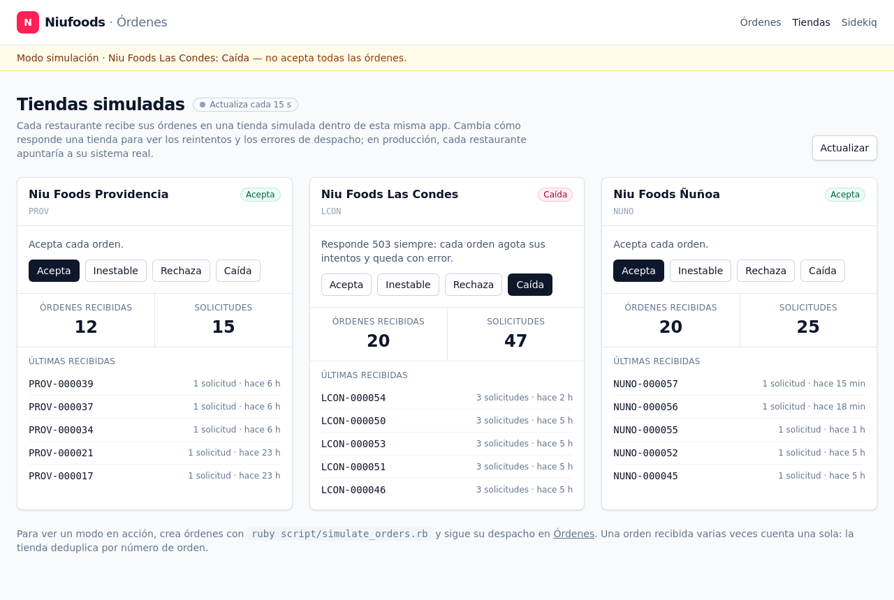

# Tiendas simuladas

Cada restaurante recibe sus órdenes en la URL guardada en `restaurants.dispatch_url`. En esta solución esas URLs apuntan a **tiendas simuladas** servidas por la misma app, para que el flujo completo se pueda ejecutar sin otros sistemas.

```
http://localhost:3000/simulated_stores/PROV/orders
http://localhost:3000/simulated_stores/LCON/orders
http://localhost:3000/simulated_stores/NUNO/orders
```

## Aislamiento

La tienda simulada (los endpoints `/simulated_stores/...`) se comporta como un sistema externo:

- vive en su propio namespace (`StoreSimulator::`) y en sus propias tablas (`simulated_store_modes` y `simulated_store_requests`);
- **no lee ni escribe ninguna tabla de órdenes**: solo conoce lo que le llega por HTTP;
- responde con su propio JSON, distinto del formato de errores de la API de órdenes.

El [panel Tiendas](#panel-tiendas) no es parte del simulador sino del dashboard: lee los restaurantes y las órdenes, y usa `StoreSimulator` para leer y cambiar los modos y las recepciones.

En producción, cada `dispatch_url` apuntaría al sistema real de la tienda y este módulo se dejaría de usar. La base de las URLs se configura con `STORE_BASE_URL` (ver `.env.example`) y se aplica al correr `bin/rails db:seed`.

## Recepción de una orden

```
POST /simulated_stores/:code/orders
Content-Type: application/json
Idempotency-Key: LCON-000042
```

El body es la orden tal como la despacha la API y se guarda sin cambios. El header `Idempotency-Key` es obligatorio: la API envía el número de la orden, así que una orden reintentada se reconoce como la misma.

| Status | `status` | Cuándo |
|---|---|---|
| `201 Created` | `received` | La tienda aceptó la orden por primera vez. |
| `200 OK` | `duplicate` | La orden ya se había recibido; no se procesa de nuevo. |
| `422 Unprocessable Content` | `rejected` | La tienda rechaza la orden (modo `reject`). |
| `503 Service Unavailable` | `unavailable` | La tienda no está disponible (modo `down` o `flaky`). |
| `400 Bad Request` | — | Falta `Idempotency-Key` o el body no es un objeto JSON. |

```json
{ "store": "LCON", "idempotency_key": "LCON-000042", "status": "received", "attempts": 3 }
```

`attempts` cuenta todas las veces que se intentó entregar esa orden a esa tienda, incluidas las fallidas.

### Deduplicación atómica

La API entrega cada orden **al menos una vez**: si no recibe la respuesta de la tienda, por ejemplo por un timeout, vuelve a intentar. La tienda tiene que recibir cada orden **una sola vez**, aunque lleguen entregas repetidas o simultáneas. Lo resuelve en tres pasos, sin la carrera de "consultar y después guardar":

1. **Contar el intento.** Un solo `INSERT ... ON CONFLICT (store_code, idempotency_key) DO UPDATE SET attempts = attempts + 1 RETURNING attempts, received_at` registra el intento y devuelve si la orden ya estaba recibida. Si lo estaba, se responde `duplicate`.
2. **Decidir la respuesta** según el modo de la tienda.
3. **Marcar la recepción**, solo si la respuesta es exitosa, con `UPDATE ... SET received_at = now(), payload = ... WHERE id = ? AND received_at IS NULL`. Si otra entrega simultánea ya la marcó, el `UPDATE` afecta cero filas y esta entrega se responde como `duplicate`.

Los intentos fallidos **nunca** quedan registrados como recepciones: `received_at` y `payload` solo se escriben en el paso 3.

## Modos

Cada tienda responde según su modo, para poder reproducir fallas de despacho a voluntad:

| Modo | Comportamiento |
|---|---|
| `ok` | Acepta todas las órdenes. |
| `flaky:N` | Responde `503` a los primeros N intentos de **cada orden** y después la acepta. |
| `reject` | Rechaza todas las órdenes con `422`. |
| `down` | Responde `503` a todo. |

El modo se resuelve en este orden:
1. el modo guardado para esa tienda;
2. la variable `STORE_MODES`, por ejemplo `STORE_MODES="PROV=ok,LCON=flaky:2,NUNO=ok"`; las entradas inválidas se ignoran;
3. `ok`.

### Consultar y cambiar el modo

Desde el navegador, en la página **Tiendas** (ver [Panel Tiendas](#panel-tiendas)), o por HTTP:

```bash
curl http://localhost:3000/simulated_stores/LCON/mode
# {"store":"LCON","mode":"ok"}

curl -X PUT http://localhost:3000/simulated_stores/LCON/mode \
  -H 'Content-Type: application/json' -d '{"mode":"flaky:2"}'
# {"store":"LCON","mode":"flaky:2"}
```

Un modo desconocido responde `422`.

### Ejemplo: tienda inestable

Con `LCON` en `flaky:2`, cuatro entregas de la misma orden responden:

```
{"store":"LCON","idempotency_key":"LCON-000042","status":"unavailable","attempts":1}  <- HTTP 503
{"store":"LCON","idempotency_key":"LCON-000042","status":"unavailable","attempts":2}  <- HTTP 503
{"store":"LCON","idempotency_key":"LCON-000042","status":"received","attempts":3}     <- HTTP 201
{"store":"LCON","idempotency_key":"LCON-000042","status":"duplicate","attempts":4}    <- HTTP 200
```

## Ver lo que recibió una tienda

```bash
curl http://localhost:3000/simulated_stores/LCON/orders
```

```json
{
  "store": "LCON",
  "mode": "flaky:2",
  "orders": [
    {
      "idempotency_key": "LCON-000042",
      "attempts": 4,
      "received_at": "2026-10-21T19:14:57.217Z",
      "payload": { "number": "LCON-000042", "total_amount": 22470 }
    }
  ]
}
```

La lista incluye las órdenes que la tienda todavía no aceptó, con `received_at: null`, y muestra las 100 más recientes.

## Panel Tiendas

La página **Tiendas** (`/stores`, en el menú de la app) permite hacer toda la demostración de fallas desde el navegador, sin `curl`. Muestra una tarjeta por restaurante:



- **Modo actual** con una etiqueta y una descripción de lo que hace, y **un botón por modo** (el actual queda marcado y deshabilitado):

  | Botón | Modo | Efecto en el despacho |
  |---|---|---|
  | Acepta | `ok` | Cada orden se entrega en el primer intento. |
  | Inestable | `flaky:2` | Cada orden falla dos veces con `503` y se entrega en el tercer intento. |
  | Rechaza | `reject` | Cada orden queda `failed` en el primer intento (`422`, error permanente). |
  | Caída | `down` | Cada orden agota sus intentos con `503` y queda `failed`. |

  El panel solo ofrece estos cuatro. Otros valores válidos, como `flaky:3`, se configuran por HTTP o con `STORE_MODES`, y el panel los muestra tal cual.
- **Órdenes recibidas:** cuántas órdenes distintas aceptó la tienda. Una orden cuenta una sola vez, aunque haya llegado varias veces, porque la tienda deduplica por número de orden.
- **Solicitudes:** todas las solicitudes HTTP que le llegaron, incluidas las que respondió con error y los reenvíos de órdenes que ya tenía. La diferencia con las órdenes recibidas son los reintentos: por ejemplo, 20 órdenes recibidas con 47 solicitudes.
- **Últimas recibidas:** las 5 órdenes aceptadas más recientes, con cuántas solicitudes necesitó cada una y hace cuánto llegaron.

**El cambio de modo es inmediato** y vale para la próxima solicitud que reciba la tienda, también para los reintentos de órdenes que ya estaban en curso. Por ejemplo, si una tienda está "Caída" y una orden va por su segundo intento, volverla a "Acepta" hace que el tercer intento se entregue.

**Aviso en toda la app:** mientras alguna tienda esté en un modo que no acepta todas las órdenes, una franja "Modo simulación" bajo el header lo indica en todas las páginas, con un enlace al panel. Así, el detalle de una orden fallida tiene su explicación a la vista. `flaky:0` no dispara el aviso, porque no falla ningún intento.

El panel se actualiza solo (cada 3 s mientras hay despachos en curso y cada 15 s si no) y lee los modos y las recepciones en un número fijo de consultas, sin importar cuántas tiendas haya.

## Alcance

Las tiendas simuladas no tienen autenticación: cualquiera que llegue a la app puede cambiar sus modos, por HTTP o desde el panel Tiendas. Es aceptable para una herramienta de demostración, pero no deberían exponerse en un entorno real.
